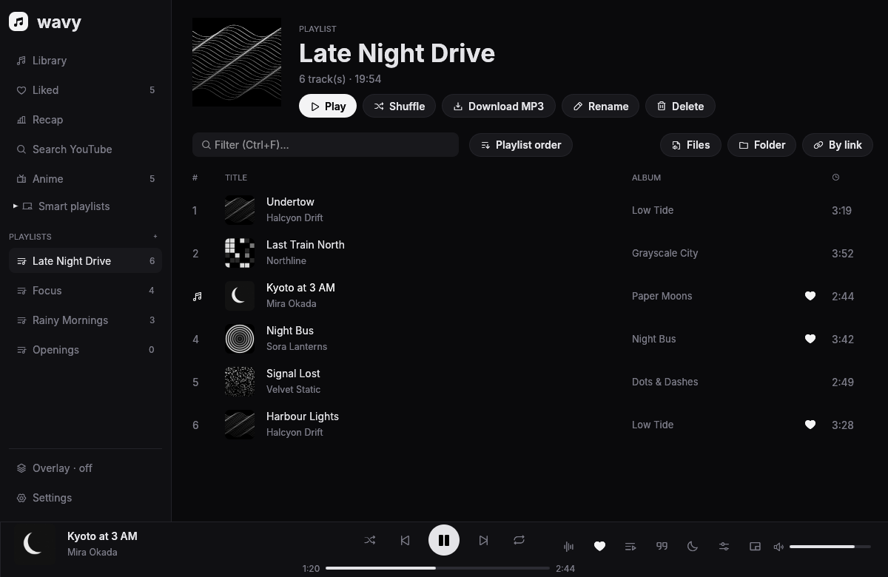
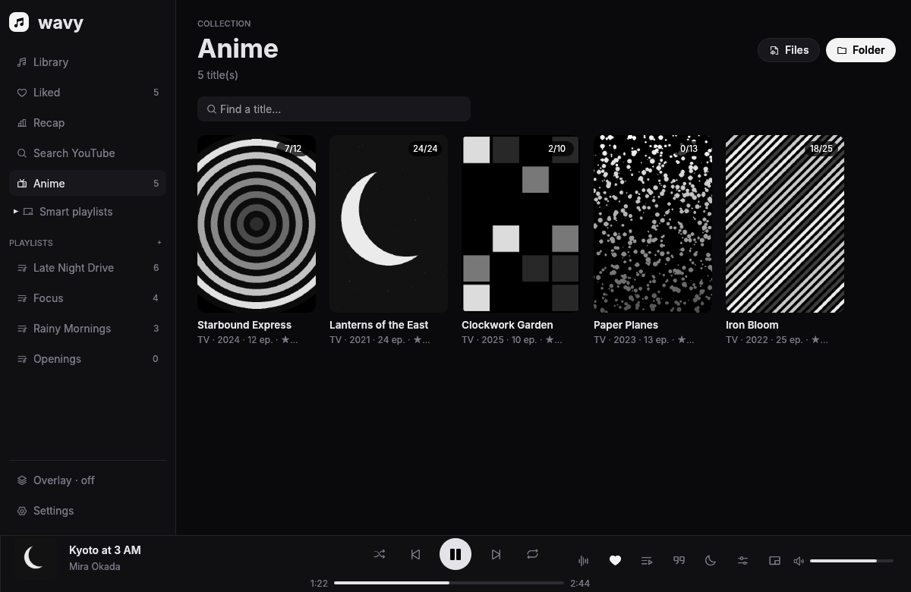
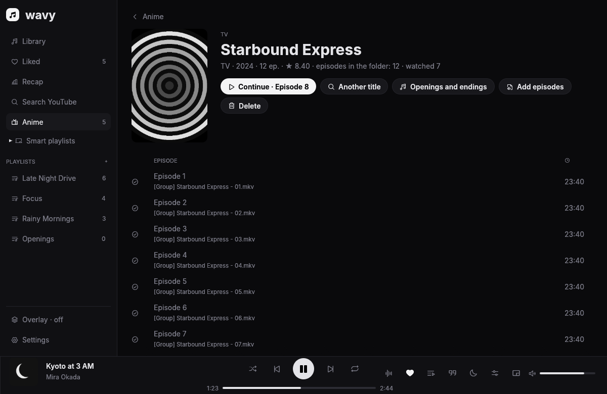
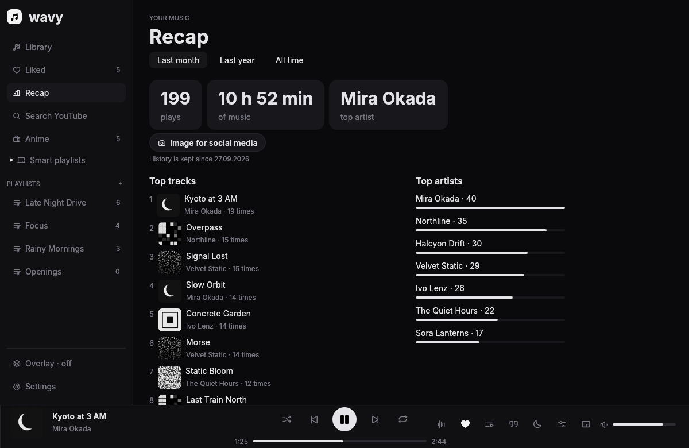
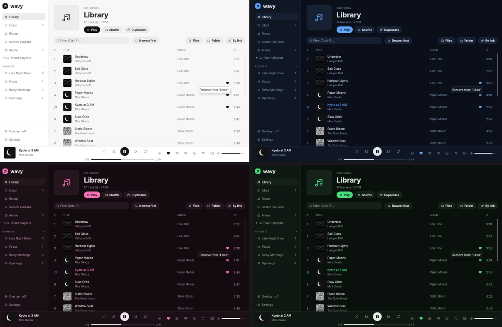
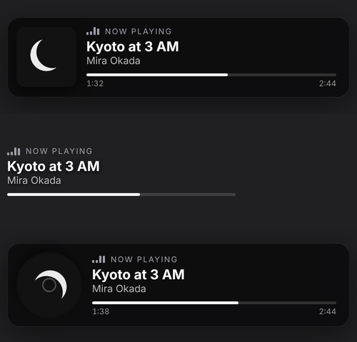
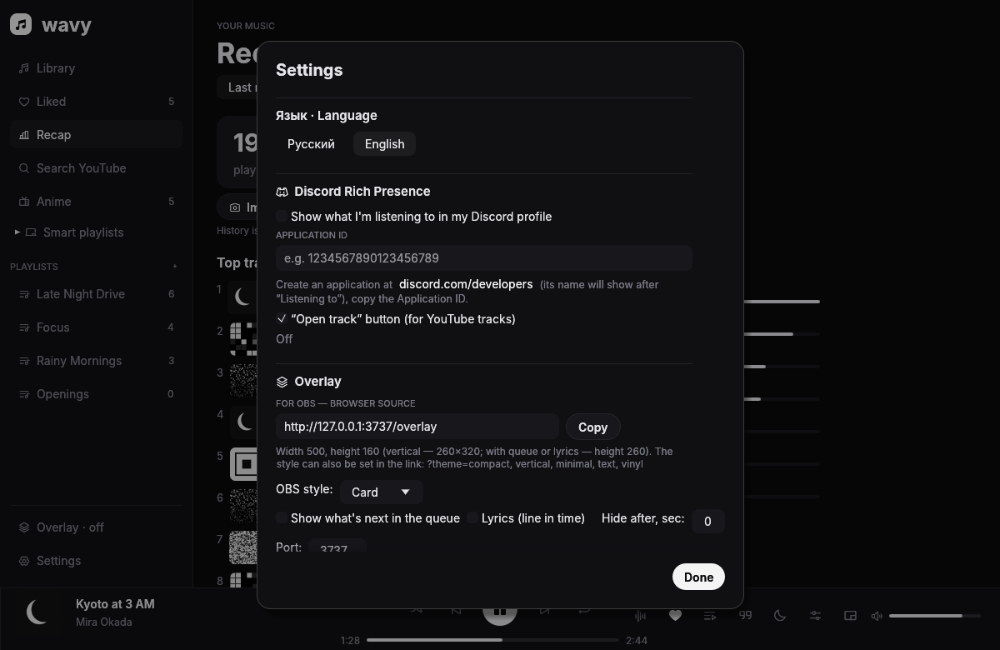

# Wavy

A lightweight native music and anime player written in Rust (egui + rodio). No browser engine: it's a single process using about 45 MB of its own memory while a track plays, and the exe is around 13 MB.


| | |
|---|---|
|  |  |
|  |  |

## Download

**[Wavy.exe — latest build](https://github.com/feelin-comatose/wavy/releases/latest/download/Wavy.exe)** (Windows 10/11 x64, no installation needed).
All builds are on the [Releases](https://github.com/feelin-comatose/wavy/releases) page. The exe is built automatically (GitHub Actions) on every code update.

## Features

- **Russian or English interface**: switch it at the very top of Settings; it applies instantly, without a restart (the tray menu updates after a restart). The phone app has the same setting: Settings → "Язык · Language".
- **Themes**: dark (the default black and white), black (AMOLED), light, ocean, sakura, forest and amber, plus a custom accent color. Pick one in Settings → Theme; it applies instantly. The phone app has the same themes.
- **Local music**: drag files, folders and `.m3u` playlists into the window or add them with the buttons. Tags and covers are read from the files. Supports mp3, flac, wav, ogg, m4a/aac, alac.
- **Spotify**: paste a link to a playlist, album or track. The list comes from Spotify and each track is found on YouTube (6 at a time, matched by duration; title and artist are taken from Spotify). Without any setup you get up to 100 tracks per playlist; for bigger playlists add a Spotify API key (Client ID + Secret) in Settings.
- **YouTube Music / YouTube / SoundCloud / Bandcamp**: import a playlist, album or video by link (or just press `Ctrl+V` in the window), search YouTube, keep a playlist in sync with its source. Under the hood it's **yt-dlp**: if it isn't installed, Wavy downloads it once by itself. Tracks are downloaded into a cache (up to ~1.5 GB) and the next one is fetched in advance.
  - If a video is deleted or becomes 18+ (YouTube won't serve those without signing in), Wavy looks for the same track in another video (up to three attempts) and remembers the replacement. To play 18+ videos themselves, set cookies in Settings ("YouTube 18+"): from Firefox (signed in to YouTube) or a `cookies.txt` file. Cookies are used only for those videos. Chrome and Edge on Windows hide their cookies, so getting them often fails.
- Playlists, queue, shuffle, repeat (off / all / one), "play next", context menu.
- **Video**: click the track block at the bottom to show the video instead of the list; click again to close it. Double-click or the corner button for full screen (`Esc` to exit).
  - YouTube tracks: the music video (H.264 up to 720p) downloads the first time you open it and plays in sync with the audio.
  - Local videos: mp4/m4v/mov/mkv/webm are added to the library as tracks. H.264 is shown by the built-in decoder. For **H.265 (HEVC), 10-bit video, VP9, AV1** and **Opus, AC3/E-AC3, DTS, TrueHD** audio, Wavy downloads its own small ffmpeg once (≈6 MB, built in CI from `scripts/build-ffmpeg.sh`). If the graphics card supports the format (D3D11VA/DXVA2), it decodes; otherwise the CPU does. AV1 without GPU support isn't shown yet.
  - Tracks without video show a large cover. The decoder (OpenH264) is built into the exe, nothing is downloaded, and while the view is closed the video takes no memory.
- **Anime**: a separate section for episodes on your computer. Drop a folder in (or press "Folder") and Wavy will:
  - work out the title and episode number from file (or folder) names: `[SubsPlease] Sousou no Frieren - 01 (1080p).mkv`, `Title.S02E05.mkv`, `Death Note/Episode 05.mkv` and so on;
  - find the title on **Shikimori** and take the poster, Russian title, year, type and episode count from there. If it picked the wrong season, choose the right one by hand ("Another title");
  - remember which episodes you've watched and where you stopped ("Continue"), and start the next episode on its own;
  - show **subtitles**: embedded in MKV (ASS/SSA/SRT) or external `.ass`/`.srt` next to the episode or in a subfolder (`Subs/`, `RUS Sub/`…). ASS styling is simplified to white text with an outline; `\an8` lines go at the top;
  - let you pick the **dub** (audio track) and subtitles right over the video. The choice is remembered for the whole title.
- **Export to MP3**: the "Download MP3" button on a playlist saves all of it to one folder (`01. Artist - Title.mp3`…), and "Save as MP3…" in the track menu saves the selected songs. Title, artist, album and cover are written into the files (ID3v2.3). YouTube songs come from the cache or are downloaded, and the same small ffmpeg (with LAME built in) encodes them. MP3 files are copied without re-encoding.
- **Shazam**: the "What's this song?" button above the video (or the wave in the player) recognises what's playing right now, an opening or ending for example, and adds the track to the library and the "Openings" playlist (the track itself is found on YouTube). Works with any file on your computer. Recognition works the same way as SongRec: a fingerprint is built from 12 seconds of audio and sent to the Shazam server.
- **Likes and "Liked"**: the heart on a track and in the player (`L`). Tracks in playlists, "Liked" and the queue can be reordered with the mouse.
- **Sorting**: playlist order, "Most played", newest/oldest, by title, artist, album. Your own picture as a playlist cover, folders for playlists.
- **Sound**: speed (slowed / nightcore), 10-band equalizer with presets, volume normalisation, crossfade 1–12 s, sleep timer.
- **Lyrics** (`T`): synced lyrics from LRCLIB; the current line is highlighted and clicking a line seeks to it.
- **Recap**: plays, minutes, top tracks and artists for the month, year or all time. Plus a duplicate finder and editing of a track's title, artist, album and cover.
- **Track radio**: similar songs from a YouTube mix are added to the queue.
- **Mini player** on top of all windows and a **tray icon** (Windows). The close button can minimise to the tray if you want.
- **Anime extras**: a "Skip opening" button (timings from AniSkip), optionally skipping automatically; "Next episode in 10 s" during the ending; watched episodes are marked in your Shikimori list (needs your own OAuth app; instructions are in Settings). The "Openings and endings" button collects every OP/ED of a title into a playlist (list from AnimeThemes or MyAnimeList, songs from YouTube). Frame screenshot: the "Frame" button or `P` (saved to "Pictures/Wavy"). Subtitles can be loaded from any file (`.ass`, `.srt`, `.vtt`).
- **For streamers**:
  - Twitch chat: `!sr link or title` to request a song, `!skip` to vote to skip (mods and the streamer skip instantly), `!song` for what's playing, `!queue` for what's next. Requests can be tied to a channel points reward (a reward "with text"). Chat is read anonymously; for Wavy to reply in chat, sign in with a code at twitch.tv/activate (your own app on dev.twitch.tv, Public type; instructions are in Settings);
  - the overlay shows what's next in the queue (with the requester's name) and the current lyrics line in time (`?queue=1&lyrics=1`);
  - **phone remote**: pause, tracks, seeking, volume and the queue over Wi-Fi (Android → Settings → "PC remote");
  - overlay styles "compact", "vertical", "text only"; the current track goes to a `now_playing.txt` file for OBS.
- **Global hotkeys** (they work in games too): pause, tracks, volume, like, skip opening, mini player, overlay. Defaults are `Ctrl+Alt+P/←/→/↑/↓/L/S/M`, and they can be reassigned in Settings.
- **YouTube Music account** (Settings → "YouTube Music account"): "Sign in with Google" opens a separate Chrome, Edge or Brave window with a clean profile; you sign in as usual, and Wavy takes the cookies and closes the window (Wavy never sees your password). Cookies from Firefox or a `cookies.txt` file also work. Once signed in you get:
  - **"My wave"** in the sidebar: endless YouTube Music radio based on your likes and history, without what's already in your library; the queue keeps filling itself;
  - **import of likes** (the "YouTube Music likes" playlist) and **saved playlists**; importing again updates them.
  Wavy is an unofficial client: the risk of an account ban is small but not zero, so a secondary account is safer.
- **Smart playlists**: top of the week and month, "On repeat", "Forgotten favorites" (likes you haven't played for a month), "Fresh", "Never played". They build themselves; any of them can be saved as a copy.
- **Last.fm**: scrobbling and "now playing" (your own Last.fm API key, sign-in through the Last.fm page).
- **Recap image**: a 1080×1350 PNG for social media with hours of music and your top tracks and artists.
- **Backups**: once a day the library is saved to a folder (the last 14 copies are kept); you can choose the folder, e.g. on another drive or in the cloud. Restore from Settings.
- **Ctrl+K command palette**: type "equalizer", "mini", or the name of a track, playlist or anime and press Enter.
- **Cache**: see how much space it takes, clear it or set a limit.
- **What's new**: the list of changes is shown after an auto-update.
- **Auto-update**: on launch and every 6 hours the player checks GitHub Releases, downloads the new version by itself and offers to restart. Turn it off in Settings → Updates.
- **Media keys** and the system media panel: on Windows it appears next to the volume flyout and shows the cover; on Linux it works through MPRIS.
- **Picks up where you left off**: after a restart you get the same track, the same queue and the same position.
- **Discord Rich Presence**: shows "Listening to …", the track, artist, cover, a progress bar and an "Open in YouTube Music" button.
- **Overlay**:
  - a window on top of games: `Ctrl+Shift+O` to show or hide, `Ctrl+Shift+L` to lock it (clicks pass through) or to move and resize it. Works in games running in "borderless windowed" mode;
  - for OBS: Browser Source `http://127.0.0.1:3737/overlay`, size 500×160;
  - themes: **card**, **minimal** (just text with a shadow), **vinyl** (a spinning record). The theme is chosen in Settings and applies both to the window and to OBS. For OBS it can be overridden: `?theme=card|minimal|vinyl`. The overlay follows the app's language; `?lang=en` or `?lang=ru` overrides it.







## Android

A native app (Kotlin, Jetpack Compose, Media3) in the `android/` folder. Download `Wavy.apk` from [Releases](https://github.com/feelin-comatose/wavy/releases/latest).

- **Themes**: the same seven themes as on the PC (Settings → Theme).
- **Background playback**: notification with buttons, lock screen, headphones, watches.
- **Music and video on the phone**: the "From phone" button finds everything in storage.
- **YouTube Music / YouTube / Spotify / SoundCloud**: search, import by link or through "Share" straight from their apps, music videos in sync with the audio. Under the hood it's NewPipeExtractor.
- **Floating mini player** on top of games and apps while Wavy is minimised. Turn it on in Settings; it needs the "Display over other apps" permission.
- **Sync with the PC**: over Wi-Fi (address and PIN from Wavy's settings on the PC) or with a `wavy-export.json` file, both ways. On the PC you can just drop the file into the window.
- **Anime**: episodes on the phone are grouped into titles, posters and names come from Shikimori, and watched episodes are marked automatically.
- **Shazam**: listens through the microphone for 12 seconds; the track it finds is added to "Openings".
- **Likes and "Liked"**: the heart in the player and in the track menu; likes move between PC and phone together with playlists.
- **Lyrics** (LRCLIB): the current line is highlighted; tap a line to seek.
- **Sleep timer** (15–90 minutes or "after this track") and **track radio**.
- **Smart playlists**: top of the week and month, "On repeat", "Forgotten favorites", "Fresh", "Never played".
- **Spotify**: tracks are searched for in YouTube Music; the ones not found can be picked by hand, and a badly matched track can be replaced ("Pick another video…" in the menu).
- **PC remote**: control Wavy on the computer over Wi-Fi.
- **Offline**: the "Download" button in a playlist saves YouTube tracks to the phone.
- **Auto-update**: checks Releases on launch and offers to install the new version.

Discord Rich Presence and the OBS overlay are PC-only: Discord doesn't offer that API on phones.

Build: `cd android && ./gradlew assembleRelease`. The APK is signed with `android/release.p12`. CI creates it on the first build and encrypts it with the password from the `WAVY_KEYSTORE_PASSWORD` secret, which the repository owner makes up.

## Hotkeys

| | |
|---|---|
| `Space` | play / pause |
| `←` `→` | seek ±5 s |
| `Ctrl+←` `Ctrl+→` | previous / next track |
| `↑` `↓` | volume |
| `M` | mute |
| `L` | like the current track |
| `Q` / `T` | queue / lyrics |
| `S` / `R` | shuffle / repeat |
| `Ctrl+F` | search the list |
| `Ctrl+K` | commands: track, playlist, setting |
| `P` | frame screenshot (in video) |
| `Ctrl+Alt+P` `Ctrl+Alt+←/→` `Ctrl+Alt+↑/↓` | pause, tracks, volume — global, in games too |
| `Ctrl+Alt+L` `Ctrl+Alt+S` `Ctrl+Alt+M` | like, skip opening, mini player — global |
| `Ctrl+V` | paste a link and import it |
| `Ctrl+Shift+O` | overlay on top of games (global) |
| `Ctrl+Shift+L` | lock / move the overlay (global) |
| media keys | play, pause, next, previous |

## Building (Windows)

1. Install Rust: https://rustup.rs (the default option, together with Visual Studio Build Tools).
2. In the project folder:
   ```bash
   cargo build --release -p wavy-native
   ```
3. The finished file, with its icon: `target\release\wavy-native.exe`. You can rename it to `Wavy.exe` and put it anywhere: no installation needed.

Linux needs `libasound2-dev` and `libxkbcommon-x11-0`.

## Discord

1. https://discord.com/developers/applications → **New Application**. Its name becomes the text "Listening to **<name>**".
2. Copy the **Application ID**, paste it into Settings → Discord and tick the checkbox.
3. Optional: under Rich Presence → Art Assets, upload an image with the key `logo`. It's shown for local tracks (YouTube tracks use their thumbnail).

Discord has to be running as the desktop app.

## Where data lives

`%APPDATA%\wavy` (Windows) or `~/.local/share/wavy` (Linux):
- `library.json`: library, playlists, settings;
- `session.json`: queue and position;
- `covers/`, `cache/`: covers and downloaded YouTube tracks;
- `bin/`: yt-dlp.

## Layout

```
core/      library (JSON), import and tags (lofty), yt-dlp, Discord RPC, HTTP/SSE overlay server for OBS
native/    interface (egui), audio (rodio), media keys (souvlaki), cover cache
overlay/   the OBS overlay page
android/   the Android app
testdata/  test cases shared by the PC and Android implementations
```

Fonts: Inter (OFL), icons: Phosphor (MIT). Details in `native/assets/README.md`.

The screenshots use a made-up demo library (artists, covers and anime titles are fictional).

## License

GPL-3.0 (see `LICENSE`): both versions use GPL-3.0 libraries — rustypipe (PC) and NewPipeExtractor (Android).
