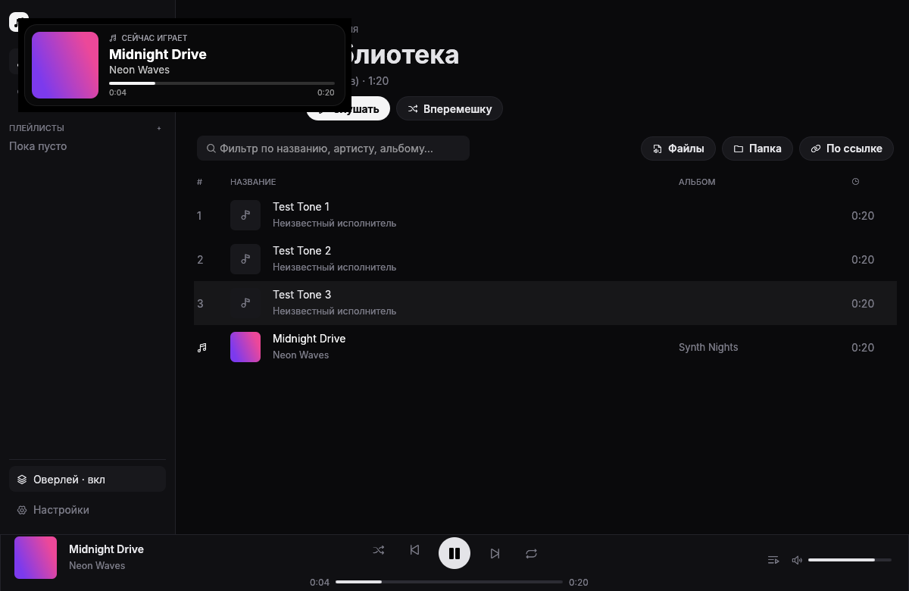
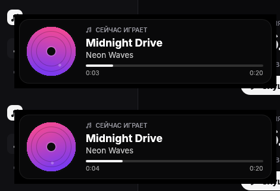

# Wavy

Лёгкий нативный музыкальный плеер на Rust (egui + rodio). Без браузерного движка: это один процесс, ~45 МБ своей памяти во время игры трека, exe около 13 МБ.



## Скачать

**[Wavy.exe — последняя сборка](https://github.com/feelin-comatose/wavy/releases/latest/download/Wavy.exe)** (Windows 10/11 x64, установка не нужна).
Все сборки — во вкладке [Releases](https://github.com/feelin-comatose/wavy/releases). Exe собирается автоматически (GitHub Actions) при каждом обновлении кода.

## Возможности

- **Локальная музыка**: файлы, папки и `.m3u` можно перетащить в окно или добавить кнопками. Теги и обложки читаются из файлов. Поддерживаются mp3, flac, wav, ogg, m4a/aac, alac.
- **Spotify**: вставь ссылку на плейлист, альбом или трек. Список берётся из Spotify, каждый трек находится на YouTube (в 6 потоков, с подбором по длительности; название и исполнитель — из Spotify). Без настроек — до 100 треков из плейлиста; для больших плейлистов можно добавить ключ Spotify API (Client ID + Secret) в настройках.
- **YouTube Music / YouTube / SoundCloud / Bandcamp**: импорт плейлиста, альбома или видео по ссылке (можно просто нажать `Ctrl+V` в окне), поиск по YouTube, синхронизация плейлиста с источником. Под капотом **yt-dlp**: если его нет в системе, он один раз скачивается сам. Трек скачивается в кэш (до ~1.5 ГБ), следующий подгружается заранее.
- Плейлисты, очередь, shuffle, repeat (выкл / всё / один), «играть далее», контекстное меню.
- **Видео**: клик по блоку с треком внизу открывает просмотр вместо списка, повторный клик закрывает его. Двойной клик или кнопка в углу — на весь экран (`Esc` — выйти).
  - YouTube-треки: клип (H.264 до 720p) скачивается при первом открытии и идёт синхронно со звуком.
  - Локальные видео: mp4/m4v/mov с H.264 добавляются в библиотеку как треки. mkv/webm (VP9/AV1) пока не поддерживаются.
  - Если у трека нет видео, показывается большая обложка. Декодер (OpenH264) встроен в exe, ничего не докачивается, а пока просмотр закрыт, видео не занимает память.
- **Автообновление**: при запуске и раз в 6 часов плеер проверяет GitHub Releases, сам скачивает новую версию и предлагает перезапуститься. Выключается в Настройки → Обновления.
- **Медиаклавиши** и системная плашка плеера: в Windows она появляется рядом с громкостью и показывает обложку; на Linux работает через MPRIS.
- **Продолжение с того же места**: после перезапуска открывается тот же трек, та же очередь и та же позиция.
- **Discord Rich Presence**: показывает «Слушает …», трек, исполнителя, обложку, полосу прогресса и кнопку «Открыть в YouTube Music».
- **Оверлей**:
  - окно поверх игр: `Ctrl+Shift+O` показать или скрыть, `Ctrl+Shift+L` закрепить (клики проходят насквозь) или двигать и менять размер. Работает в играх в режиме «оконный без рамки»;
  - для OBS: Browser Source `http://127.0.0.1:3737/overlay`, размер 500×160;
  - темы: **карточка**, **минимал** (только текст с тенью), **винил** (крутящаяся пластинка). Тема выбирается в настройках и действует и в окне, и в OBS. Для OBS её можно переопределить: `?theme=card|minimal|vinyl`.



## Android

Нативное приложение (Kotlin, Jetpack Compose, Media3) в папке `android/`. Скачать: `Wavy.apk` в [Releases](https://github.com/feelin-comatose/wavy/releases/latest).

- **Фоновое воспроизведение**: уведомление с кнопками, экран блокировки, наушники, часы.
- **Музыка и видео с телефона**: кнопка «С телефона» находит всё в памяти.
- **YouTube Music / YouTube / Spotify / SoundCloud**: поиск, импорт по ссылке или через «Поделиться» прямо из их приложений, клипы синхронно со звуком. Под капотом NewPipeExtractor.
- **Плавающий мини-плеер** поверх игр и приложений, когда Wavy свёрнут. Включается в настройках, нужно разрешение «Поверх других приложений».
- **Синхронизация с ПК**: файл `wavy-export.json` в обе стороны (Настройки → Синхронизация). На ПК файл можно просто перетащить в окно.
- **Автообновление**: при запуске проверяет Releases и предлагает поставить новую версию.

Discord Rich Presence и оверлей для OBS есть только на ПК: Discord не даёт такого API на телефонах.

Сборка: `cd android && ./gradlew assembleRelease`. APK подписывается ключом `android/release.p12`, пароль берётся из секрета `WAVY_KEYSTORE_PASSWORD`.

## Горячие клавиши

| | |
|---|---|
| `Space` | играть / пауза |
| `←` `→` | перемотка ±5 с |
| `Ctrl+←` `Ctrl+→` | предыдущий / следующий трек |
| `Ctrl+V` | вставить ссылку и импортировать |
| `Ctrl+Shift+O` | оверлей поверх игр (глобально) |
| `Ctrl+Shift+L` | закрепить / двигать оверлей (глобально) |
| медиаклавиши | играть, пауза, вперёд, назад |

## Сборка (Windows)

1. Поставь Rust: https://rustup.rs (вариант по умолчанию, вместе с Visual Studio Build Tools).
2. В папке проекта:
   ```bash
   cargo build --release -p wavy-native
   ```
3. Готовый файл с иконкой: `target\release\wavy-native.exe`. Его можно переименовать в `Wavy.exe` и положить куда угодно: установка не нужна.

Linux: нужны `libasound2-dev`, `libxkbcommon-x11-0`.

## Discord

1. https://discord.com/developers/applications → **New Application**. Название станет текстом «Слушает **<название>**».
2. Скопируй **Application ID** и вставь его в Настройки → Discord, поставь галочку.
3. Необязательно: в Rich Presence → Art Assets загрузи картинку с ключом `logo`. Она показывается у локальных треков (у YouTube-треков подставляется превью).

Discord должен быть запущен как десктоп-приложение.

## Где лежат данные

`%APPDATA%\wavy` (Windows) или `~/.local/share/wavy` (Linux):
- `library.json`: библиотека, плейлисты, настройки;
- `session.json`: очередь и позиция;
- `covers/`, `cache/`: обложки и скачанные YouTube-треки;
- `bin/`: yt-dlp.

## Структура

```
core/      библиотека (JSON), импорт и теги (lofty), yt-dlp, Discord RPC, HTTP/SSE-сервер оверлея для OBS
native/    интерфейс (egui), аудио (rodio), медиаклавиши (souvlaki), кэш обложек
overlay/   страница оверлея для OBS
```

Шрифты: Inter (OFL), иконки: Phosphor (MIT). Подробности в `native/assets/README.md`.
